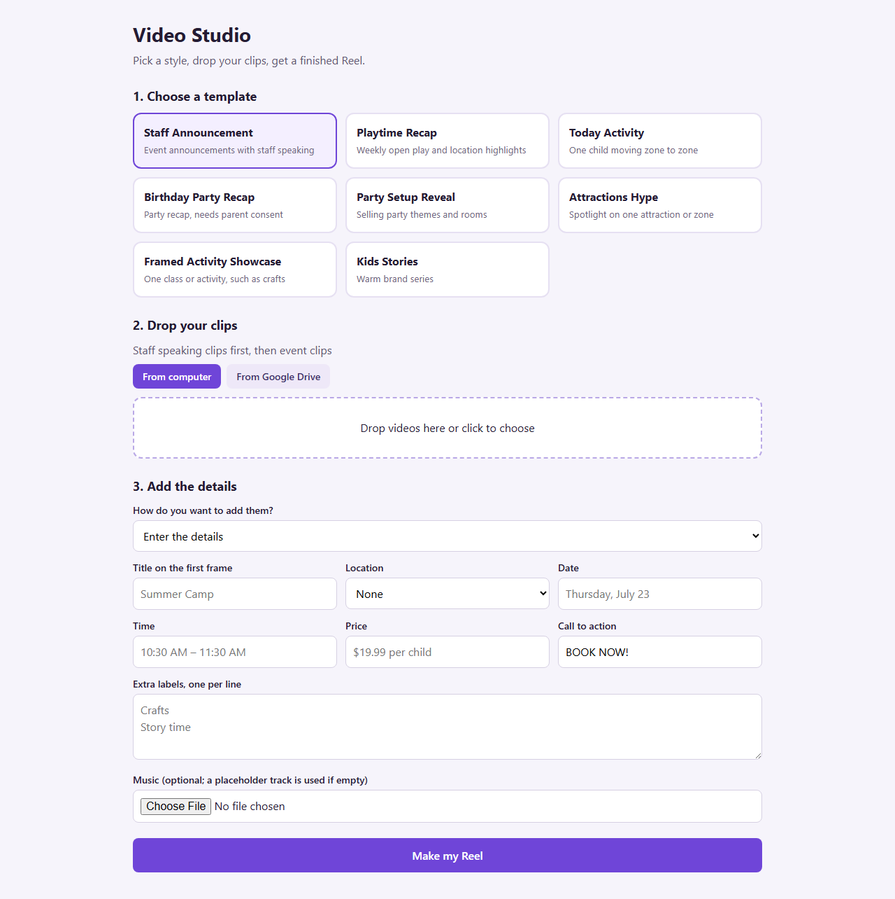
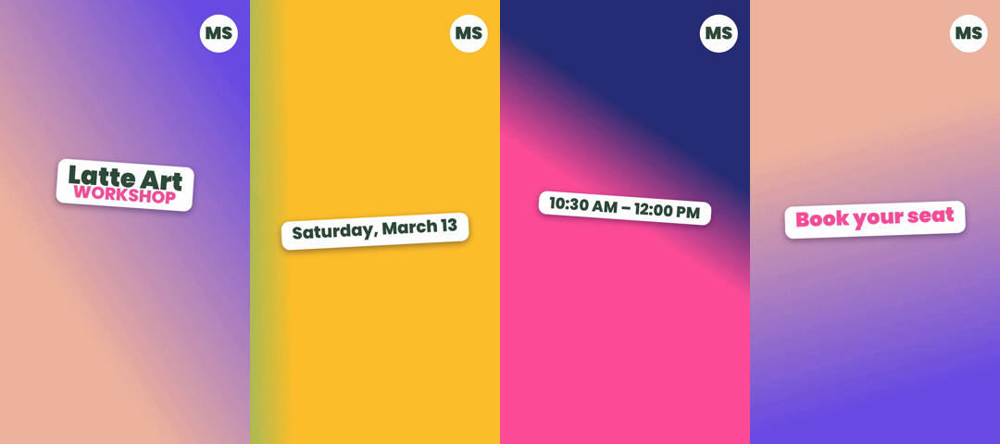

# reel-builder

A marketing team was spending its month on the same video, over and over. This turns those repeat Reels into a 3 to 4 minute job.



*Video Studio: pick a template, drop clips, add the details, get a finished Reel*

## The problem

One company needed about 300 videos a month across 15 accounts. Nearly all of them looked alike. Most were announcements in the same template style, with a new date, location and offer each time.

Editors were cutting the same structure by hand and rewriting the same on-screen text. The work was mundane, and it used up the time that should have gone to creative ideas.

## What changed

The system was taught on 25 of the company's past Reels, which became 8 ready templates in their existing style. Announcements, recaps, party reveals and the rest each have their own pacing, colour and transitions.

- **Before:** an editor builds each video by hand on a timeline
- **Now:** pick a template, drop clips from a computer or Google Drive, then type the details or paste a script
- **Time:** a finished Reel in 3 to 4 minutes at most
- **Result:** the mundane part is gone, so the team can spend its time on the creative work

Staff speech is transcribed automatically, and clips are picked by motion scoring. A person still reviews each video, because motion scoring can't judge faces or story.

## What's in this repo

The team's Video Studio and templates are private. This repo is the open version of the render engine: describe the shots in JSON and get a finished vertical Reel with every cut on the beat.



*Frames from the demo reel*

## How it works

- Times every shot in beats, so cuts land on the music
- Renders sticker titles with a pop-in animation
- Covers each cut with a torn-paper wipe
- Synthesises an original backing track, so there's no music licensing to clear
- Adds your logo and exports H.264 at 1080x1920

## Run it

```bash
pip install -r requirements.txt
# ffmpeg must be on PATH
python make_demo_assets.py
python reel.py reel.example.json   # writes out/reel.mp4
```

## Notes

The demo uses generated gradients and a fictional brand. The Video Studio screenshot has client names and locations replaced. Sample output: [docs/demo.mp4](docs/demo.mp4). Fonts are Poppins, under the SIL Open Font License.

## Stack

Python, ffmpeg, Pillow, NumPy

Built by [Vinay Kumar](https://vinaykumar.work) with Claude Code. I set the design and rules and reviewed the output.
